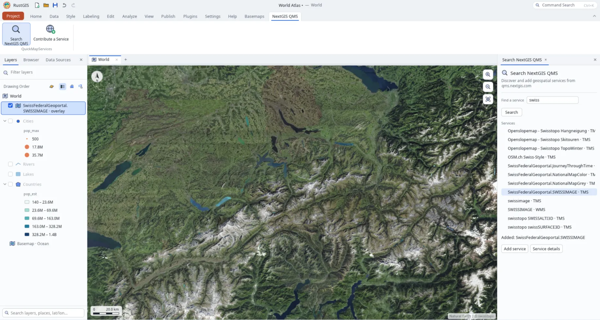
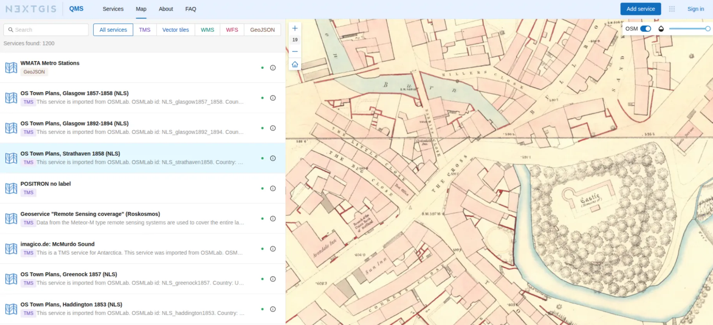

# NextGIS QuickMapServices for RustGIS

NextGIS QuickMapServices search panel for RustGIS. Access more than 1200 geospatial services (TMS, WMS, WFS, GeoJSON, Vector Tiles) directly from RustGIS interface.

## Why QuickMapServices

Many public basemaps and geospatial services exist on the web, but configuring them manually requires copying URLs, setting parameters, and understanding service specifications.

QuickMapServices simplifies this process by providing:

- a searchable catalog of services
- one‑click addition of services to RustGIS

This helps GIS users focus on analysis and mapping instead of service configuration.

## QuickMapServices Catalog

QuickMapServices relies on an open catalog of geospatial services available at https://qms.nextgis.com

The catalog allows users to:

- browse available basemaps and geodata services
- view service metadata and previews
- contribute new services to the catalog
- reuse the catalog in external GIS tools and applications

The catalog is community‑driven and continuously updated.

## Usage

1. Open the **NextGIS QMS** -> **Search NextGIS QMS**
2. Enter the name of a service (for example *OpenStreetMap* or *Satellite*)
3. Push **Search** button or press **Enter**
4. Select relevant service from search results
5. Push **Add service** button

The selected service will be added to your RustGIS project.

Second button, **Contribute a service**, will show you information about how to add your own service to the public catalog.

## Contributing

You can contribute to the QuickMapServices ecosystem in several ways:

### Add new services

New services can be added through the [catalog interface](https://qms.nextgis.com)

### Improve the plugin

Bug reports and feature requests are welcome through [GitHub issues](https://github.com/nextgis/nextgis-qms-rustgis).

## Documentation

📘 [QMS Catalog FAQ](https://qms.nextgis.com/faq)

## Community

💬 [Community forum](https://community.nextgis.com)

## License

MIT. This is an independent plugin that accesses the publicly documented NextGIS QMS API.